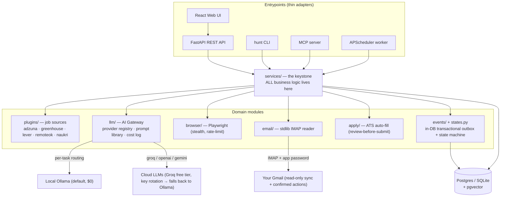
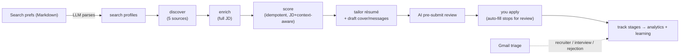
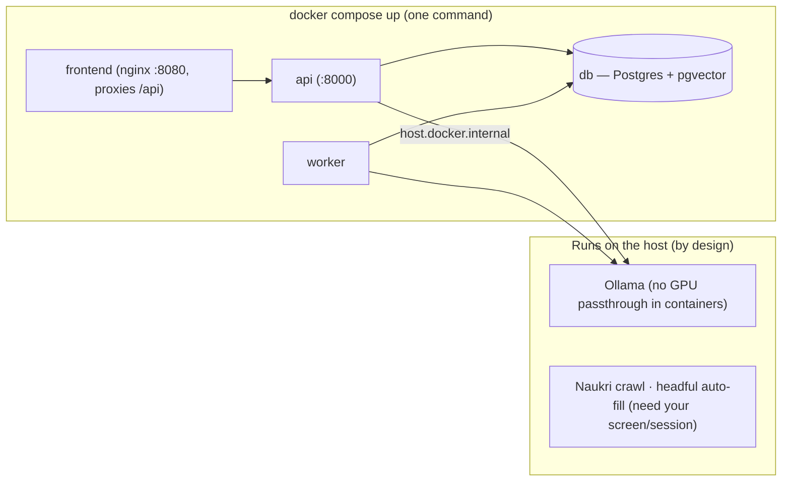

# Architecture — job-hunt ("Career OS")

A self-hosted, single-user job-hunt platform. Local-first (Ollama = $0), quality-over-quantity,
**human-in-the-loop for everything that matters** (review before submit; confirm before any mailbox
mutation). This document is the system architecture; coding standards live in `backend/CLAUDE.md`.

## System at a glance

## The keystone: `services/`

Every entrypoint (Web UI → API, CLI, MCP host, background worker) calls the **same** `services/`
functions. Business logic and `init_db()` live there; entrypoints are thin adapters. Services return
plain dicts (`{"error": "…"}` on user-fixable failures — `api/app.py::_unwrap` maps that to 4xx). No
duplicated logic across the four surfaces.

## The pipeline

Driven by an **in-DB transactional outbox** (`events/bus.py`) + a **job state machine**
(`states.py`): events are written in the *same transaction* as the state change that produced them
(no external broker — no Kafka/Redis), with retries + dead-lettering. The worker drains the outbox on
a short cadence and auto-advances `discovered → enriched → scored → …`.

## AI Gateway (`llm/`)

- **Per-task routing** — each task (`scoring`, `drafting`, `email_structure`, …) resolves its own
  `(provider, model)` from env (`LLM_<TASK>_PROVIDER/MODEL`), with an optional fallback provider.
- **Providers:** `ollama` (local, default, $0) · `groq` (free/fast, LPU) · `openai` · `gemini` · `stub`.
  Groq/OpenAI/Gemini share one OpenAI-compatible client. **Groq adds key rotation** (on `429`/`401`,
  rotate keys; when exhausted, **fall back to local Ollama** — effectively unlimited free).
- **Prompt library** — versioned `Prompt(name, version, system, schema)` objects; JSON tasks are
  schema-validated with a repair retry.
- **Cost log** — every call is logged to `llm_calls` (tokens + $), surfaced in Analytics.

## Storage

- **Dual backend** behind one façade (`storage/repo.py`): `sqlite` (`db.py`, tests) or `postgres`
  (`pg.py`, prod, pgvector). Raw SQL, no ORM. Postgres migrations auto-apply (`migrations/00NN_*.sql`,
  currently through `0020`); SQLite schema is the inline `SCHEMA` string.
- **Core tables:** `jobs` (state machine), `scores`, `resume_variants`, `drafts`, `applications`,
  `companies`, `runs`, `events` (outbox), `llm_calls`, `search_profiles`, embeddings (pgvector).
- **Personalization singletons:** `user_context`, `applicant_profile`, `search_prefs`.
- **Email:** `email_messages`, `email_sync_state`, `email_actions`.

## Feature surfaces

| Capability | Where |
|---|---|
| Discover · enrich · score · tailor · cover · **thank-you/follow-up/negotiation drafts** | services + `plugins/`, `resume/`, `draft/`, `scoring/` |
| **Inbox triage** (read/structure/link) + **confirmed actions** (draft/label/archive) | `email/` + `services/email_triage.py` |
| **ATS auto-fill** (Greenhouse/Lever, stops at review) | `apply/` + `apply/formfill.py` |
| **Interview prep brief**, **User Context**, **Applicant profile**, **Search prefs (Markdown)** | `services/` singletons + LLM |
| **Content posts** (unique tech-post drafts every 3 days → you post) | `content/` + `services/content.py` + Content page |
| Notifications (Telegram/Discord daily digest) | `notify/` |
| Semantic search | `embed/` + pgvector |

## Security boundaries (by design)

- **Human-in-the-loop:** auto-fill stops at the review screen; email actions require an explicit
  `confirm=True`; nothing is auto-sent or auto-applied.
- **Untrusted content:** email bodies are treated as *data, never instructions* — the structuring
  prompt is injection-hardened, drafts are grounded in *extracted* fields (not raw bodies), and no
  model output can trigger a mailbox mutation (spy-tested).
- **No scraping / no evasion:** sources are official APIs (Adzuna/Greenhouse/Lever/RemoteOK) or your
  own authenticated Gmail (IMAP); no LinkedIn scraping, no anti-bot detection-evasion.
- **Secrets:** API token, Gmail app password, and provider keys live in `backend/.env.local` only —
  never logged, stored in the DB, or placed in a prompt.

## Deployment

Containers cover the server stack; **Ollama** and the **browser-interactive** features stay on the
host (documented in the README). `Makefile` wraps it: `make up · logs · down · host-cli · notify-test`.
